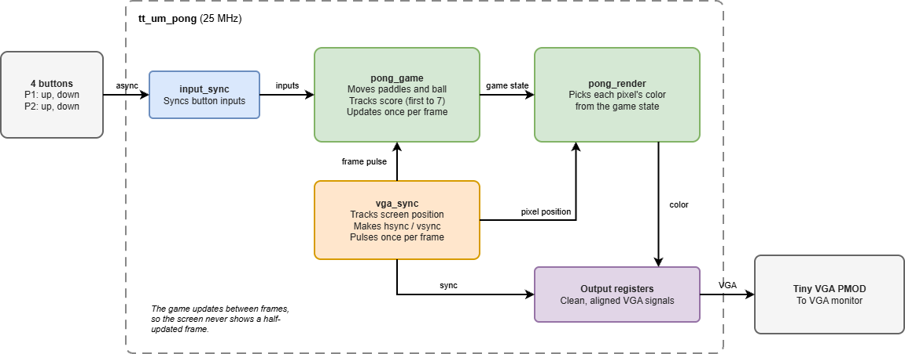

<!---
Used to generate the Tiny Tapeout project datasheet. Images in this folder must be <512 kb each, <1 MB combined.
-->

## How it works

Two-player Pong rendered as a 640x480 @ 60 Hz VGA signal. Four buttons (up/down per player) move the paddles; the design is pure RTL (Verilog-2005) with no frame buffer: every pixel is computed combinationally from the current beam position and the game state registers.



### Clocking and I/O

- Clock: 25 MHz (nominal 25.175 MHz pixel clock; 25.000 MHz is within VGA monitor tolerance). One pixel per clock.
- Reset: `rst_n` (active low), applied synchronously. All state registers use synchronous reset.
- Buttons are asynchronous: each passes through a 2-FF synchronizer before use. No debounce is needed because paddle motion is sampled once per frame.
- VGA output uses the [Tiny VGA PMOD](https://github.com/mole99/tiny-vga) pinout (2 bits per color, 6 bits total).

| Pin | Dir | Signal | Pin | Dir | Signal |
|-----|-----|--------|-----|-----|--------|
| `ui[0]` | in | P1 up | `uo[0]` | out | R1 (MSB) |
| `ui[1]` | in | P1 down | `uo[1]` | out | G1 (MSB) |
| `ui[2]` | in | P2 up | `uo[2]` | out | B1 (MSB) |
| `ui[3]` | in | P2 down | `uo[3]` | out | VSYNC |
| `ui[7:4]`, `uio[7:0]` | - | unused (`uio_oe = 0`) | `uo[4]` | out | R0 (LSB) |
| | | | `uo[5]` | out | G0 (LSB) |
| | | | `uo[6]` | out | B0 (LSB) |
| | | | `uo[7]` | out | HSYNC |

### VGA timing (640x480 @ 60 Hz, 25 MHz)

| | Visible | Front porch | Sync (active low) | Back porch | Total |
|---|---|---|---|---|---|
| Horizontal (pixels) | 640 | 16 | 96 | 48 | 800 |
| Vertical (lines) | 480 | 10 | 2 | 33 | 525 |

`h_cnt` (0-799) and `v_cnt` (0-524) are 10-bit counters; `h_cnt` wraps and increments `v_cnt`. Color outputs are forced to 0 outside the visible area (`h_cnt < 640 && v_cnt < 480`) and during blanking. HSYNC is low for `h_cnt` 656-751; VSYNC is low for `v_cnt` 490-491.

### Module structure

| Module (file) | Role |
|---|---|
| `tt_um_pong` (`project.v`) | TT top level: pin mapping, wires the blocks together (instances `btn_sync`, `vga`, `game`, `render`), output registers |
| `vga_sync` (`vga_sync.v`) | `h_cnt`/`v_cnt`, `hsync`, `vsync`, `active`, and a one-cycle `frame_tick` at the start of vertical blanking (`h_cnt==0 && v_cnt==480`) |
| `input_sync` (`input_sync.v`) | 2-FF synchronizer for the four buttons |
| `pong_game` (`pong_game.v`) | Paddle, ball and score state; updated only on `frame_tick` |
| `pong_render` (`pong_render.v`) | Combinational pixel-in-object comparators -> 2-bit RGB |
| `pong_defs.vh` | Shared `localparam` constants (geometry, speeds, timing, colors), `` `include ``d inside each module body. It is a header, so it is not listed in `source_files` / `PROJECT_SOURCES`; it is found next to the including file / via `-I src` |

### Game rules and update logic (all in `pong_game`, once per frame)

Coordinates are in pixels, origin top-left. Because state only changes on `frame_tick` (during blanking), rendering never sees a half-updated frame.

- **Paddles:** 8 px wide, 64 px tall, left at x=16, right at x=616. `*_y` is the top edge (10-bit). Each frame, up moves it -4 px, down +4 px, both/neither holds; clamped to `[0, 480-64]`.
- **Ball:** 8x8 px, position `ball_x`/`ball_y` (10-bit, top-left corner), velocity ±4 px/frame horizontally and ±3 px/frame vertically, stored as one direction bit each with constant magnitude (`ball_vx_neg_q` = moving left, `ball_vy_neg_q` = moving up). Each frame: `pos += vel`. After reset the ball is at the center (316, 236) and is served right and down.
- **Wall bounce:** if the next `ball_y` would touch or leave `[0, 480-8]`, clamp it to the wall and flip the `vy` direction in the same frame (so the ball never rests on a wall for an extra frame).
- **Paddle bounce:** only the paddle the ball is moving toward is checked. If the ball is currently in front of the paddle face and its next x position would touch or cross that face (`ball_x` = 24 for the left paddle, 608 for the right), and its next y-range overlaps the paddle's span, the ball is placed on the face and `vx` is *set* to point away from the paddle. The `vy` direction is set from the hit zone, measured as ball center minus paddle top: < 21 px (upper third) -> up, >= 43 px (lower third) -> down, otherwise unchanged.
- **Scoring:** if the ball's leading edge would leave the screen (next `ball_x` < 0: right player scores; next `ball_x` > 640-8: left player scores), increment that score (3-bit, 0-7), then re-serve: ball at screen center, `vx` toward the player who just lost the point, `vy` direction from bit 0 of a 4-bit LFSR.
- **Serve randomness:** the LFSR (x^4+x^3+1, period 15) steps once per frame and additionally on every clock while any button is held, so the players' button timing is the entropy source. A purely free-running LFSR would not work: a frame is 420000 clocks, an exact multiple of 15, so it would show the same value at every `frame_tick`.
- **Game over:** when either score reaches 7, the ball is frozen at center until reset (the score boxes remain visible as the result). Paddles still move.

The paddle check is a *crossing* test on the pre-update position plus velocity rather than a plain overlap test. This avoids tunnelling, and because the direction is set (not toggled) and only a ball in front of the face can bounce, a ball can never get stuck flipping direction inside a paddle. A ball that has already passed the face is a miss and continues to the edge. Positions are unsigned; the "x < 0" case is detected as `ball_x < 4` while moving left, so nothing ever wraps.

### Rendering (`pong_render`)

Pure combinational function of `h_cnt`, `v_cnt`, and game state, computed from range comparators (no memories). Where objects overlap, priority is ball > paddles > score boxes > net:

| Object | Condition | Color |
|---|---|---|
| Paddles | `h_cnt`/`v_cnt` inside paddle rect | white (`R=G=B=11`) |
| Ball | inside 8x8 ball rect | yellow (`R=G=11`, `B=00`) |
| Center net | `h_cnt` in 319-320 and `v_cnt[4]` (2 px wide, dashed 16 px on / 16 px off) | grey (`R=G=B=01`) |
| Score boxes | row y in 8-15; one box per point on an 8 px pitch, 6 px lit + 2 px gap so points can be counted; left player boxes starting at x=240 going right, right player boxes starting at x=392 going right (`n < score`) | green (left) / red (right) |
| Background | otherwise | black |

Output registers: RGB and syncs are registered once so outputs are glitch-free (one pixel of latency; sync and color are delayed together to stay aligned).

### Timing / area notes

- The critical path is the render comparators (10-bit compares into a priority mux) -> output register; at 25 MHz this is far from limiting.
- Target 1x1 tile. If area utilization is too high, first drop the score display or reduce counter widths; move to 1x2 only if needed.
- `pong_game` has no multipliers or dividers: all motion is add/subtract of small constants.

## How to test

### Simulation

RTL is Verilog-2005; the testbenches are SystemVerilog and self-checking. Run:

```bash
cd test
./run_tests.sh      # exit 0 only if every testbench prints TESTBENCH_RESULT: PASS
```

The runner uses Icarus Verilog (`iverilog -g2012`) if it is on the PATH, otherwise Questa/ModelSim (`vlog`/`vsim`). It first compiles the RTL alone as strict Verilog-2005, then builds and runs each testbench; `./run_tests.sh tb_pong_game` runs just one. Each testbench prints `[PASS]`/`[FAIL]` per check and a final `TESTBENCH_RESULT: PASS|FAIL` line.

A real frame is 420000 clocks, so the tests are split in two:

**`test/tb_pong_game.sv`** - unit test of `pong_game` with `frame_tick` driven directly (thousands of game frames in about a second):

- **Reset:** paddles centered, ball at center, scores 0; nothing moves without `frame_tick`.
- **Paddles:** up/down move 4 px per frame, clamp at top and bottom, ignore simultaneous up+down.
- **Ball:** moves `vx`/`vy` per frame; bounces off top/bottom; bounces off each paddle in each hit zone, including corner hits and one-pixel misses.
- **Scoring/game over:** score increments for the correct player, re-serve at center toward the loser, freeze at 7, reset clears.
- **LFSR:** steps on `frame_tick` and while a button is held, visits all 15 states.
- **Whole-game runs:** an unforced first point from reset (frame-exact), and a 1500-frame rally where both paddles track the ball through the buttons and nobody may score.

**`test/tb_pong.sv`** - top-level test of `tt_um_pong` at real VGA timing:

- **VGA timing:** `hsync` period = 800 clocks, pulse width 96 clocks; `vsync` period = 525 lines, pulse width 2 lines.
- **Reset / buttons:** reset state, then `ui_in` driven for several frames through the synchronizer.
- **Rendering:** a monitor compares all 8 output pins on every clock against an independent reference model (colors, blanking and sync position), plus per-frame pixel counts per color and sampled pixels (paddle, ball, net, score boxes, background, blanking).

Top-level tests use a frame-count helper (wait N `frame_tick`s) instead of cycle counts. Game state is checked, and occasionally preset, through hierarchical references (`dut.game.ball_x_q` etc.).

`test/test.py` (cocotb, with `test/tb.v`) is what the Tiny Tapeout CI runs for RTL and gate-level simulation. It is a pins-only smoke test: reset, then check the `hsync`/`vsync` pulse widths and periods.

### On hardware

1. Connect a Tiny VGA PMOD to the `uo` header and a monitor to its VGA port.
2. Set the TT clock to 25 MHz and release `rst_n`.
3. Drive `ui[0]`/`ui[1]` (player 1) and `ui[2]`/`ui[3]` (player 2) high with push buttons (pull-downs required; pressed = 1).
4. The ball serves automatically. First to 7 wins; reset to play again.

## External hardware

- [Tiny VGA PMOD](https://github.com/mole99/tiny-vga) on the output header + VGA monitor.
- Four push buttons (active high, with pull-down resistors), e.g. on a PMOD button board, connected to `ui[0]`-`ui[3]`.
